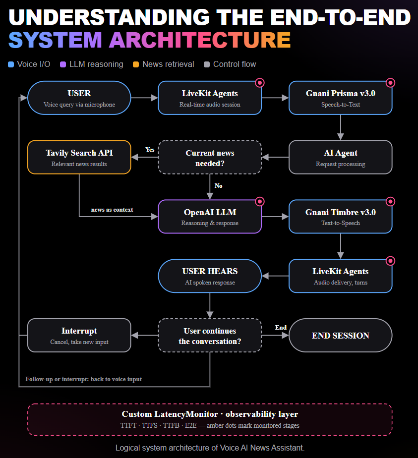

# 🎙️ Voice AI News Assistant
### A Real-Time Conversational AI News Experience

**Developed by: Rakesh Bishnoi**  
**Hackathon:** Gnani Great Indian AI Internship Challenge

Voice AI News Assistant is a real-time, voice-based AI news assistant that helps users discover and understand current news through natural conversations. Users can ask questions using their voice, receive AI-generated spoken responses, explore current developments through web search, and continue the conversation with follow-up questions.

## Project Demo Video

Watch the Voice AI News Assistant demonstration:

**[▶️ Watch the Direct Project Demo Video on You-tube](https://youtu.be/vGPM5Ca2UVU)**

---

## 1. Problem Statement

News and updates are distributed across multiple websites and platforms. Finding relevant information, reading lengthy articles, and comparing developments can be time-consuming.

Most traditional news experiences are also primarily one-way, making it difficult for users to ask follow-up questions or redirect an explanation while listening.

## 2. Proposed Solution

Voice AI News Assistant provides a conversational way to explore current news.

The user speaks a question, the application converts speech into text, processes the request using an AI model, and retrieves current information through web search when required. The generated response is then converted into speech and delivered to the user.

Users can also:
- Ask questions about current news.
- Receive spoken AI-generated explanations.
- Ask follow-up questions for more context.
- Interrupt and redirect the assistant's response.
- Explore news topics through natural voice interaction.

## 3. Target Users

- People who want quick spoken summaries of current news.
- Students and professionals who need to explore topics while multitasking.
- Users who prefer listening to explanations instead of navigating multiple articles.
- Voice-interface users who value follow-up questions and conversational control.

## 🛠️ 4. Technology Stack

| Technology | Role |
|---|---|
| **LiveKit Agents** | Real-time voice sessions, audio handling, and conversation turn management. |
| **Gnani Prisma v3.0** | Speech-to-Text (STT): converts user speech into text. |
| **Gnani Timbre v3.0** | Text-to-Speech (TTS): converts assistant responses into spoken audio. |
| **OpenAI** | Language understanding, reasoning, and response generation. |
| **Tavily** | Web search for retrieving relevant current information and news. |
| **Python** | Application logic and integration of system components. |
| **Custom LatencyMonitor** | Captures performance metrics across the voice pipeline. |

## 🇮🇳 5. Gnani AI Integration

Gnani AI provides the speech-processing layer of this application through two models:

### Gnani Prisma v3.0 — Speech-to-Text
- Processes incoming user voice input.
- Converts spoken questions into text.
- Used with the `en-IN` language configuration and verbatim transcription format in the tested session.

### Gnani Timbre v3.0 — Text-to-Speech
- Converts AI-generated text responses into spoken audio.
- Enables users to listen to news explanations instead of reading them.

**Integration workflow:** Prisma processes the user's incoming speech, while Timbre generates the assistant's outgoing speech. LiveKit Agents manages the real-time voice session around these components.

## 6. Core System Capabilities

| Capability | Description | Baseline Evidence |
|---|---|---|
| Voice Input | Accepts spoken questions and transcribes them. | English voice transcription demonstrated. |
| News Retrieval | Searches for current information when needed. | Tavily returned three results for an AI-development query. |
| AI Response | Generates conversational explanations and answers. | Responses and a follow-up comparison were generated. |
| Spoken Output | Reads assistant responses aloud. | Speech output demonstrated, with some provider errors. |
| Follow-up Interaction | Allows users to ask additional questions. | Follow-up question demonstrated. |
| Interruption Handling | Allows users to interrupt and redirect responses. | Interrupted states observed; reliability requires further testing. |
| Performance Monitoring | Measures key latency stages in the voice pipeline. | Baseline metrics captured during testing. |

## 7. System Architecture

The application follows a voice-processing pipeline:

1. **User Input:** The user asks a question through the microphone.
2. **Real-Time Session:** LiveKit Agents manages the audio session.
3. **Speech Recognition:** Gnani Prisma v3.0 converts the incoming speech into text.
4. **Request Processing:** The AI agent processes the recognized query.
5. **News Retrieval:** Tavily searches for current information when required.
6. **Response Generation:** OpenAI generates the conversational response.
7. **Speech Synthesis:** Gnani Timbre v3.0 converts the response into audio.
8. **Audio Delivery:** LiveKit delivers the generated audio to the user.
9. **Conversation Continuation:** The user can ask follow-up questions or redirect the conversation.

The following diagram illustrates the complete voice-processing workflow:

## 8. Baseline Performance Results

The following measurements were collected during an approximately four-minute test session on **November 10, 2026**.

**Important:** These measurements represent an initial baseline, not a controlled benchmark. Most metrics have five samples, while end-to-end latency has four complete measurements. Different latency metrics have different measurement definitions and should not be added together.

## 9. Functional Testing Summary

The application was tested through an end-to-end voice session.

| Test Area | Observed Result |
|---|---|
| Agent Startup | Successful; Gnani and OpenAI plugins registered. |
| Voice Input | English speech was transcribed. |
| Date/Time Tool | Executed successfully. |
| News Search | Tavily returned three results for the query "Anthropic AI development". |
| Follow-up Question | A follow-up comparison request was processed. |
| Spoken Response | Demonstrated, with occasional errors. |
| Interruption | Interrupted states were recorded; success rate was not measured. |
| Session Reliability | STT, TTS, and WebSocket issues occurred. |

## 10. Future Improvements

The next development priorities include:

- Improving STT and TTS session reliability.
- Implementing stronger WebSocket reconnection and retry handling.
- Reducing time to first response and overall end-to-end latency.
- Strengthening interruption and barge-in behavior through repeatable tests.
- Validating Hindi and Hinglish recognition before claiming multilingual support.
- Adding deeper observability for conversations, tool calls, and provider errors.
- Exploring personalized news briefings, topic preferences, and source comparisons.

## 12. Developer Contribution

**Rakesh Bishnoi — Project Developer**

- Developed the project concept and application workflow.
- Integrated the real-time voice-agent workflow using LiveKit Agents.
- Integrated Gnani Prisma v3.0 for speech recognition.
- Integrated Gnani Timbre v3.0 for speech synthesis.
- Integrated OpenAI for language understanding and response generation.
- Integrated Tavily for current news retrieval.
- Implemented custom latency monitoring.
- Conducted end-to-end testing and baseline performance analysis.

## 13. Test Scope and Limitations

- Performance results are based on one approximately four-minute session.
- Only four complete end-to-end latency measurements were available.
- Most other performance metrics had five samples.
- The tested STT configuration was `en-IN` with verbatim format; Hindi/Hinglish recognition has not been verified.
- Interruption events were observed, but interruption accuracy and barge-in success rate were not quantified.
- News retrieval was demonstrated, but the factual accuracy of each retrieved story was not independently evaluated.
- Some STT, TTS, and WebSocket reliability issues were observed during testing.

---

## 🔗 14. Project & Social Media

- **GitHub Repository:** [Voice AI News Assistant](https://github.com/JavaOnTheRocks/AI-News-Assistant)
- **LinkedIn Project Post:** [View LinkedIn Post]()
- **X (Twitter) Project Post:** [View X Post](https://x.com/RAKESHBISH16054/status/2120166041888436452?a=gkeLbUPNuuC5khn1tJI&s=20)

---

**Voice AI News Assistant**  
*Turning news discovery into a conversation.*

Developed by **Rakesh Bishnoi** for the **Gnani Great Indian AI Internship Challenge**.

#GnaniAI #GreatIndianAIInternshipChallenge #VoiceAI #ConversationalAI #ArtificialIntelligence #SpeechToText #TextToSpeech #LiveKit
